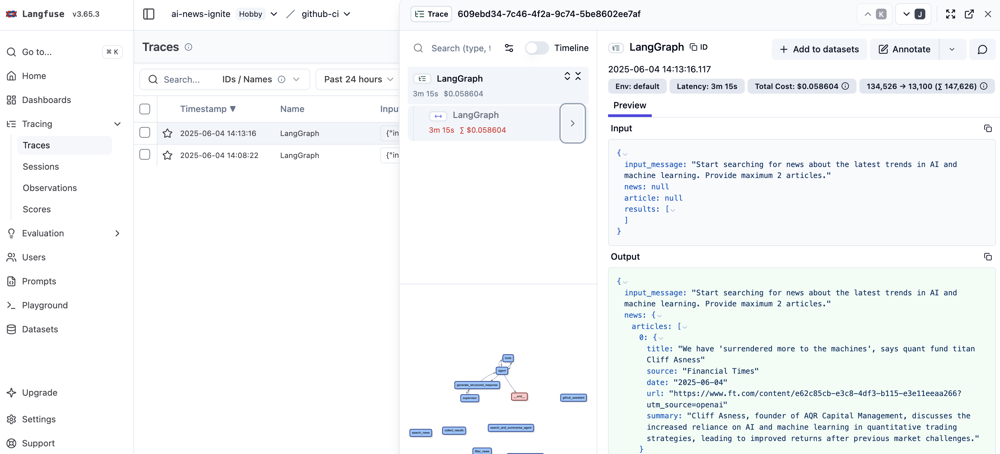

# AI News Ignite

[](https://www.python.org)
[](LICENSE)
[](https://github.com/langchain-ai/langgraph)

Automated technical intelligence briefings for LLM engineers. A LangGraph workflow searches recent AI engineering work, keeps items with a public artifact and real technical substance, and publishes each briefing by opening a pull request and merging it into `main`.

## Flow

1. **Search** the last 14 days, widening to 30 days only when fewer than 5 items qualify.
2. **Filter** items already covered in `news/`, unless the new item is a substantial technical update.
3. **Verify and rank** against primary sources. Ranking uses technical significance, not popularity.
4. **Summarize and publish** each surviving item: open a pull request, then merge it into `main`.
5. **Collect** the drafted briefings.

Each briefing has: What Changed, Why It Matters, Evidence, Links, and Assessment. GitHub star counts appear only when they were read from GitHub.

## Setup

1. Clone the repository and install dependencies. Docker must be running; the GitHub steps use the GitHub MCP server.

   ```bash
   git clone https://github.com/jeff52415/ai-news-ignite.git
   cd ai-news-ignite
   uv sync
   ```

2. Create a fine-grained personal access token for `jeff52415/ai-news-ignite` with:

   - **Contents:** Read and write
   - **Pull requests:** Read and write

   Contents writes the branch. Pull requests opens the pull request and merges it.

3. Configure environment variables in `.env` for local runs, and as repository secrets for GitHub Actions:

   ```bash
   # Required
   OPENAI_API_KEY=your_openai_key
   GIT_PERSONAL_ACCESS_TOKEN=your_github_token

   # Optional - tracing
   LANGFUSE_SECRET_KEY=your_langfuse_secret
   LANGFUSE_PUBLIC_KEY=your_langfuse_public
   LANGFUSE_HOST=https://cloud.langfuse.com
   ```

   The app reads `GIT_PERSONAL_ACCESS_TOKEN`. Langfuse 5 prefers `LANGFUSE_BASE_URL`, and still accepts `LANGFUSE_HOST`. This project turns tracing on only when `LANGFUSE_HOST` is set. Use the same URL for both if you set both.

4. Run:

   ```bash
   uv run python app.py
   ```

## Configuration

Search windows, finding limits, models, and prompts are set in `config.yaml`. GitHub Actions runs the same command on Tuesday and Friday at 00:00 UTC, and on manual dispatch.

## Monitoring

When the Langfuse variables are set, traces are sent to the Langfuse dashboard.


